### hey, i'm ananmay 👋
 
computer engineering @ umd '28
 
i build backend systems and full-stack apps.
 
### currently exploring
 
- distributed systems and fault tolerance
- scalable apis and data pipelines
- cloud infrastructure
- shipping llm features in production apps
### find me
 
[linkedin](https://linkedin.com/in/ananmaysingh) · [portfolio](https://ananmays.github.io/portfolio/)
